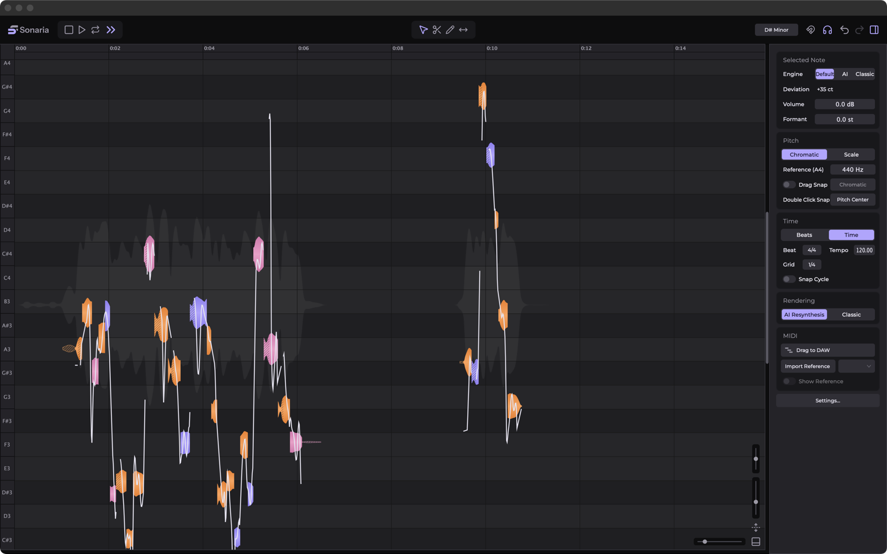
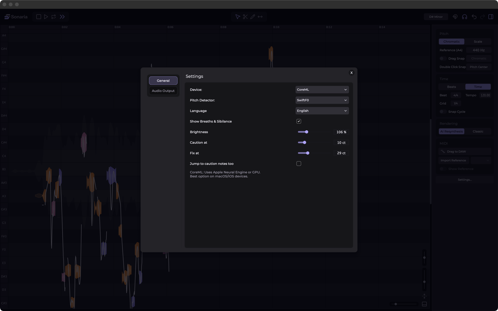

<div align="center">
  <h1>Sonaria</h1>
  <p>補正の速さ、ハモリ作り、ハイブリッド合成エンジンを目指すオープンソースのボーカルピッチエディタ</p>
  <p><a href="README.md">English</a> | 日本語</p>
</div>



*ノートを選んだところ。「選択ノート」カードに、エンジン・ずれ・音量・フォルマントが出ます。*

## 由来・帰属・ライセンス

Sonaria は Session Loops とコントリビューターによる [PitchNet](https://github.com/SessionLoops/PitchNet) のハードフォークです。PitchNet は HachiTune コントリビューターによる [HachiTune](https://github.com/KCKT0112/HachiTune) を改変した派生物で、Sonaria は両プロジェクトのコードを多く含みます。このリポジトリは派生物の単独の著作者であるとは主張しません。

Sonaria は [SessionLoops/PitchNet@dc2c1b3](https://github.com/SessionLoops/PitchNet/commit/dc2c1b362d17461c37cfab0fd468a3fa359750dd)（2026-11-12）を全履歴ごと取り込んだものです。本家の変更は必要なものだけ手で取り込み、取り込んだコミットは [README.md](README.md#origin-attribution-and-license) の表に記録します。

Sonaria は [GNU Affero General Public License バージョン 3](LICENSE)（AGPLv3）で配布します。複製や改変版を頒布するときは、該当する著作権・ライセンス・帰属の表示を残し、AGPLv3 の定めに従って対応するソースコードを公開してください。サードパーティのコンポーネントとモデルのライセンスは [THIRD_PARTY_NOTICES.txt](THIRD_PARTY_NOTICES.txt) にまとめています。

## 目標

PitchNet の機能はすべて残したうえで、次の 3 点に取り組みます。

- **作業速度**: Quantize / Straighten、ずれたノートの色分けとジャンプ、キーボードだけの編集、スケールの自動適用
- **ハモリ**: 主旋律を複製して度数でシフトし、他トラックをゴースト表示しながら揃える
- **ハイブリッドエンジン**: ニューラルボコーダー・PSOLA・スペクトル包絡エンジンをノート単位で選び、のちに自動で振り分ける

計画は [docs/implementation/roadmap.md](docs/implementation/roadmap.md) にあります。

## 概要

ピアノロールでボーカルのピッチを編集するスタンドアロンアプリとオーディオプラグインです。ニューラルピッチ検出（RMVPE / FCPE）で音声を解析し、GAME モデルでノートに分け、ニューラルボコーダー（PC-NSF-HiFiGAN）でリアルタイムに再合成します。編集結果はすぐに試聴でき、音声または MIDI で書き出せます。ARA 対応ホストと、ARA を使わない取り込み方式の両方で動きます。

## 機能（Sonaria で追加したもの）

- ずれの色分け: ノートを、キーのスケールからどれだけずれているかで色分けします。N / Shift + N で、次 / 前の直すべきノートへジャンプします
- Q / W で選んだノートを Quantize / Straighten し、H でスケールの度数単位で動かします
- ノートごとの合成エンジン（既定 / AI / クラシック）: E キー、ノートの右クリック、サイドパネルの「選択ノート」カードから選べます
- ライブ試聴: ノートをドラッグしている間、その音を聞けます
- アプリの設定（言語・表示・ずれのしきい値）は設定画面にまとめました



## 機能（PitchNet から引き継いだもの）

- ピアノロール編集（選択・分割・ピッチ描画・タイミングの各モード）
- ニューラルピッチ検出（既定は FCPE、RMVPE も選べる）
- GAME によるノート分割（D3PM 拡散モデル）
- ノートごとのピッチカーブ調整（delta・scale・offset・tilt・variance）
- ボコーダーによる差分のリアルタイム再合成（PC-NSF-HiFiGAN）
- ブレス・歯擦音の検出、母音を保つノートの伸縮、ブレスノート、ノート単位の Sibilant Balance（[詳細](docs/breath-sibilance-detection.md)）
- [r8brain-free-src](https://github.com/avaneev/r8brain-free-src) による高品質なサンプルレート変換
- すべての編集操作の取り消し・やり直し
- 音声（WAV）と MIDI の書き出し
- スタンドアロンと VST3 / AU プラグイン（AAX は任意、ARA 対応）
- Windows では CUDA / DirectML、macOS では CoreML による GPU 処理
- 多言語 UI（英語・スペイン語・日本語・韓国語・ポルトガル語・ロシア語・簡体字中国語・繁体字中国語）

## ダウンロード

Sonaria のリリースはまだありません。下の手順でソースからビルドしてください。

## 必要なもの

- CMake 3.22 以上
- C++17 コンパイラ
- Git（サブモジュール用）

| プラットフォーム | 必要なもの |
| --- | --- |
| Windows | Visual Studio 2019 以上（C++ ワークロード）、Windows SDK |
| macOS | Xcode とコマンドラインツール |
| Linux | GCC / Clang、ALSA の開発用ライブラリ |

## モデルとアセット

ビルドには `Resources/models` に次のファイルが必要で、足りないとビルドが失敗します。

- `pc_nsf_hifigan.onnx`（ボコーダー）
- `rmvpe.onnx`（ピッチ検出。このリポジトリには含まれていません。[THIRD_PARTY_NOTICES.txt](THIRD_PARTY_NOTICES.txt) を参照）
- `fcpe.onnx`（ピッチ検出、任意）
- `GAME/`（ノート分割: `encoder.onnx`、`estimator.onnx`、`segmenter.onnx`、`dur2bd.onnx`、`bd2dur.onnx`、`config.json`）
- `cent_table.bin`
- `mel_filterbank.bin`

PC-NSF-HiFiGAN と GAME の重みは CC BY-NC-SA 4.0 のため、Sonaria は非商用に限って使えます。各モデルのライセンスは [docs/reference/models.md](docs/reference/models.md) にあります。

## ビルド

```bash
git submodule update --init --recursive
cmake -B build -DCMAKE_BUILD_TYPE=Release
cmake --build build --config Release
```

CUDA・DirectML・ASIO などのオプションとプラグイン形式の条件は [README.md](README.md#optional-flags) を参照してください。

## 使い方

1. 音声ファイル（WAV / MP3 / FLAC / OGG）を開く
2. 解析してピッチを検出し、ノートに分ける
3. ピアノロールでピッチ・タイミング・表情を編集する
4. ニューラルボコーダーでリアルタイムに試聴する
5. 編集した音声または MIDI を書き出す

ARA モードではホストの音声を直接扱います。Sonaria は Cubase と Studio One で動作を確認し、Logic はビルドのみ確認します。ARA に対応しないホストでは、音声を自動で取り込んで処理します。

## 謝辞

オープンソースコミュニティの次のモデルを使っています。

- [GAME](https://github.com/openvpi/GAME) — [OpenVPI](https://github.com/openvpi) によるノート分割モデル
- [PC-NSF-HiFiGAN](https://github.com/openvpi/vocoders) — [OpenVPI](https://github.com/openvpi) によるニューラルボコーダー
- [RMVPE](https://github.com/yxlllc/RMVPE) — [yxlllc](https://github.com/yxlllc) によるピッチ推定モデル

サンプルレート変換には Aleksey Vaneev による [r8brain-free-src](https://github.com/avaneev/r8brain-free-src)（MIT License）を使っています。

## ライセンス

[LICENSE](LICENSE) を参照してください。
