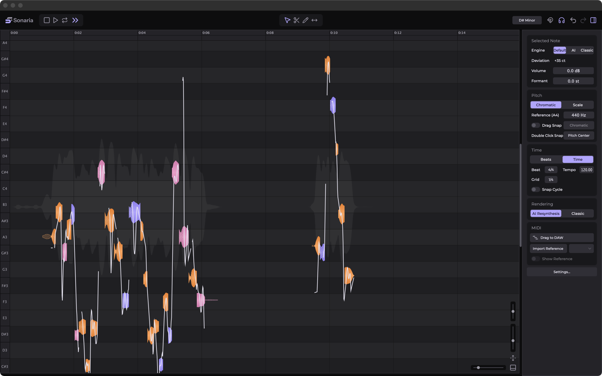
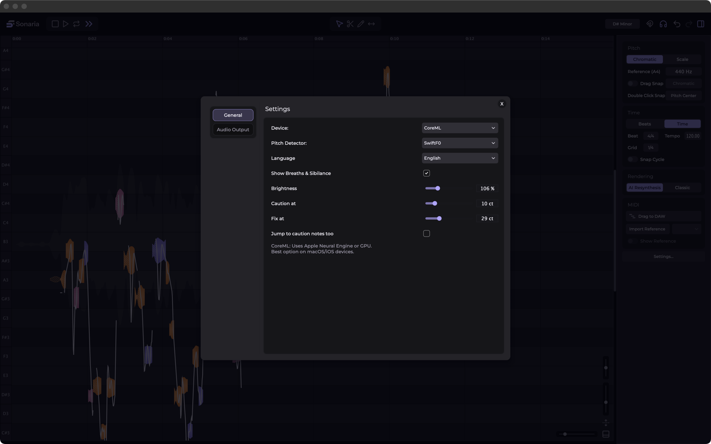

<div align="center">
  <h1>Sonaria</h1>
  <p>An open-source vocal pitch editor for fast correction, harmony creation and a hybrid synthesis engine.</p>
  <p>English | <a href="README.ja.md">日本語</a></p>
</div>



*The editor with a note selected: the Selected Note card shows its engine, deviation, volume and formant.*

## Origin, attribution, and license

Sonaria is a hard fork of [PitchNet](https://github.com/SessionLoops/PitchNet) by Session Loops and contributors, which is itself a modified derivative of [HachiTune](https://github.com/KCKT0112/HachiTune) by the HachiTune contributors. Sonaria includes substantial code from both projects. This repository does not claim sole authorship of the derived work.

Sonaria is imported from
[SessionLoops/PitchNet@dc2c1b3](https://github.com/SessionLoops/PitchNet/commit/dc2c1b362d17461c37cfab0fd468a3fa359750dd)
(2026-11-12) with full history. Upstream changes are cherry-picked by hand; each import is listed below.

| Upstream commit | Imported |
|---|---|
| `dc2c1b362d17461c37cfab0fd468a3fa359750dd` | 2026-11-15 (initial fork) |

Sonaria is distributed under the [GNU Affero General Public License, version 3](LICENSE) (AGPLv3). When conveying copies or modified versions, preserve all applicable copyright, license, and attribution notices, and make the corresponding source available as required by the AGPLv3. Third-party components and model licenses are listed in [THIRD_PARTY_NOTICES.txt](THIRD_PARTY_NOTICES.txt).

## Goals

Sonaria keeps everything PitchNet does and works toward three things:

- **Editing speed**: quantize / straighten, highlighting and jumping to off-pitch notes, keyboard-only editing, automatic scale application
- **Harmony**: duplicate the lead, shift it by scale degree, and align it while other tracks are shown as ghosts
- **Hybrid engine**: choose a neural vocoder, PSOLA or spectral-envelope engine per note, and later route notes automatically

The plan is in [docs/implementation/roadmap.md](docs/implementation/roadmap.md).

## Overview

Sonaria is a standalone app and audio plugin for editing vocal pitch in a piano roll. It analyzes audio using neural pitch detectors (RMVPE / FCPE), segments notes with the GAME model, and resynthesizes edits in real time through a neural vocoder (PC-NSF-HiFiGAN). Edits are previewed instantly with minimal latency and exported as audio or MIDI. The plugin supports both ARA hosts and a non-ARA capture workflow.

## Features

Added in Sonaria:

- Deviation colours: each note is coloured by how far it sits from the key's scale;
  N / Shift + N jump to the next / previous note that needs fixing
- Q / W quantize or straighten the selected notes, H shifts them by a scale degree
- Per-note synthesis engine (Default / AI / Classic): press E, right-click a note,
  or use the Selected Note card in the side panel
- Live audition: hear a note while you drag it
- App settings (language, display, deviation thresholds) in the Settings dialog



Inherited from PitchNet:

- Piano roll editing with select, split, pitch drawing, and timing modes
- Neural pitch detection (FCPE default, RMVPE optional)
- GAME-based note segmentation with D3PM diffusion model
- Pitch curve editing with per-note delta, scale, offset, tilt, and variance controls
- Real-time incremental vocoder resynthesis (PC-NSF-HiFiGAN)
- Breath and sibilance detection: consonants join the note they lead into,
  breaths stay out of notes, breaths and sibilants keep the original
  recording when notes are retuned, and both are hatched in the piano roll
  with no pitch curve over them ([details](docs/breath-sibilance-detection.md))
- Stretching a note holds its vowel: consonants keep their recorded length
  and the original recording ([details](docs/breath-sibilance-detection.md#stretching-notes))
- Breath notes: every breath is drawn as its own note - drag it to change its
  level ([details](docs/breath-sibilance-detection.md#breath-notes))
- Sibilant Balance per note, like Melodyne's: turn down a note's sibilants or
  the rest of it ([details](docs/breath-sibilance-detection.md#sibilant-balance))
- High-quality, band-limited audio sample-rate conversion with
  [r8brain-free-src](https://github.com/avaneev/r8brain-free-src)
- Undo/redo for all editing operations
- Export audio (WAV) and MIDI
- Standalone app plus VST3/AU plugins (AAX optional, ARA supported)
- GPU acceleration via CUDA or DirectML on Windows; CoreML on macOS
- Multi-language UI (English, Spanish, Japanese, Korean, Portuguese, Russian, Chinese Simplified, Chinese Traditional)

## Download

There are no Sonaria releases yet. Build from source as described below.

## Requirements

- CMake 3.22+
- C++17 compiler
- Git (for submodules)

### Platform notes

| Platform | Requirements |
| --- | --- |
| Windows | Visual Studio 2019+ with C++ workload, Windows SDK |
| macOS | Xcode + command line tools |
| Linux | GCC/Clang, ALSA development libraries |

## Models and Assets

The build expects required model files in `Resources/models` and will fail if any are missing:

- `pc_nsf_hifigan.onnx` (vocoder)
- `rmvpe.onnx` (pitch detection; not in this repository, see [THIRD_PARTY_NOTICES.txt](THIRD_PARTY_NOTICES.txt))
- `fcpe.onnx` (pitch detection, optional)
- `GAME/` (note segmentation: `encoder.onnx`, `estimator.onnx`, `segmenter.onnx`, `dur2bd.onnx`, `bd2dur.onnx`, `config.json`)
- `cent_table.bin`
- `mel_filterbank.bin`

The PC-NSF-HiFiGAN and GAME model weights are licensed CC BY-NC-SA 4.0, so Sonaria is for non-commercial use only. See [docs/reference/models.md](docs/reference/models.md) for every model's license.

Other runtime assets live in `Resources/lang` and `Resources/fonts`.

## Build

### Submodules

```bash
git submodule update --init --recursive
```

### Configure

```bash
cmake -B build -DCMAKE_BUILD_TYPE=Release
```

### Build

```bash
cmake --build build --config Release
```

### Optional flags

- `-DUSE_CUDA=ON` Enable CUDA execution provider (Windows)
- `-DUSE_DIRECTML=ON` Enable DirectML execution provider (Windows)
- `-DUSE_ASIO=ON` Enable ASIO support (Windows)
- `-DUSE_BUNDLED_CUDA_RUNTIME=ON` Bundle CUDA redistributables (Windows)
- `-DUSE_BUNDLED_DIRECTML_RUNTIME=ON` Bundle DirectML runtime (Windows)
- `-DONNXRUNTIME_VERSION=1.19.2` Override ONNX Runtime version

Notes:
- CUDA and DirectML cannot be enabled at the same time.
- ONNX Runtime is downloaded during CMake configure.

## Plugin Formats

- VST3 and AU are built by default.
- AAX is built only when `AAX_SDK_PATH` is set and valid.
- ARA is enabled when the `third_party/ARA_SDK` submodule is present.

## Usage

1. Open an audio file (WAV/MP3/FLAC/OGG).
2. Analyze to detect pitch and segment notes.
3. Edit notes in the piano roll — adjust pitch, timing, and expression.
4. Preview changes in real time via the neural vocoder.
5. Export the edited audio or MIDI.

### Plugin modes

- **ARA mode**: Direct audio access in supported hosts. Sonaria is tested in Cubase and Studio One; Logic is build-only.
- **Non-ARA mode**: Auto-capture and process in hosts without ARA.

## Project Structure

```
sonaria/
  Source/
    Audio/        # Audio engine, pitch detection, synthesis, vocoder
    Models/       # Project, note, and audio data models
    UI/           # Piano roll, toolbar, and UI components
    Utils/        # Resampling, localization, mel spectrogram utilities
    Undo/         # Undo/redo action system
    Plugin/       # VST3/AU/AAX/ARA plugin integration
  Resources/
    models/       # ONNX models and data files
    lang/         # Localization JSON (en, ja, zh, zh-TW)
    fonts/        # UI fonts
    svg/          # Toolbar icons
  third_party/
    JUCE/             # JUCE framework (submodule)
    ARA_SDK/          # ARA SDK (submodule, optional)
    r8brain-free-src/ # High-quality audio resampler (submodule)
  CMakeLists.txt
```

## Acknowledgements

This project uses the following models from the open-source community:

- [GAME](https://github.com/openvpi/GAME) — Note segmentation model by [OpenVPI](https://github.com/openvpi)
- [PC-NSF-HiFiGAN](https://github.com/openvpi/vocoders) — Neural vocoder by [OpenVPI](https://github.com/openvpi)
- [RMVPE](https://github.com/yxlllc/RMVPE) — Robust pitch estimation model by [yxlllc](https://github.com/yxlllc)

Audio sample-rate conversion uses
[r8brain-free-src](https://github.com/avaneev/r8brain-free-src) by Aleksey
Vaneev under the MIT License.

## License

See `LICENSE`.
